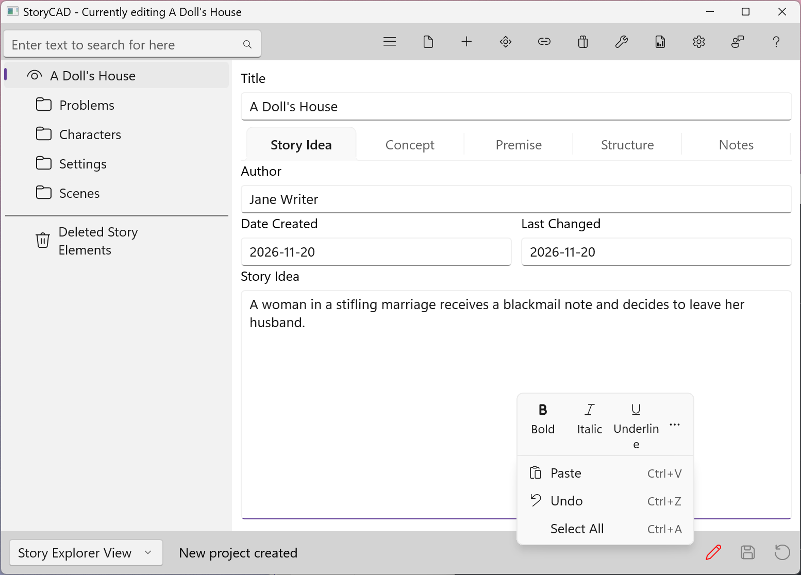

## Platform Differences

StoryCAD is available on Windows and macOS. All outlining and story planning features work the same on both platforms.

### Menu Bar

On macOS, StoryCAD provides a native menu bar at the top of the screen covering the same commands as the in-window toolbar. See [Menu Bar](../Quick Start/Menu_Bar.md) for details.

### Text Editing

| Feature | Windows | macOS |
|---------|---------|-------|
| Rich text formatting (bold, italic, underline) | Yes | Yes |
| Right-click formatting menu | Yes | Yes |
| Spell checking | Yes | Yes |

On both Windows and macOS, you format text from the right-click menu. Select the text, right-click it, and choose **Bold**, **Italic** or **Underline**:

Both platforms check your spelling as you type. A misspelled word gets a red underline; right-click the word to see suggested spellings. On Windows, StoryCAD uses the Windows spell checker. On macOS, StoryCAD uses its own spell checker with a US English dictionary.

On both platforms, text takes the text color of the theme you pick in [Preferences](../Preferences/Preferences.html): black in the light theme, light in the dark theme. Text you type in one theme stays readable after you change to the other.

### File Compatibility

StoryCAD .stbx outline files work on both Windows and macOS. You can create an outline on one platform and open it on the other. Your story content, structure, and all story elements transfer.

Bold, italic and underline also transfer. Text you format on Windows keeps its formatting when you open and save the outline on macOS, and the reverse.
