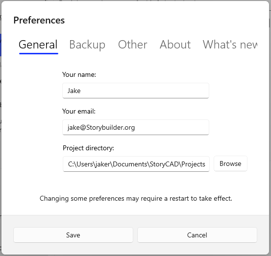
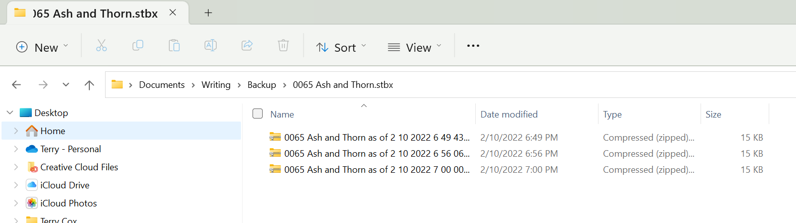
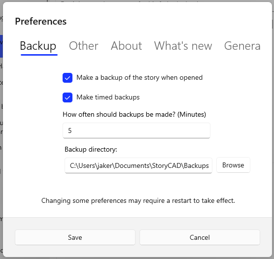
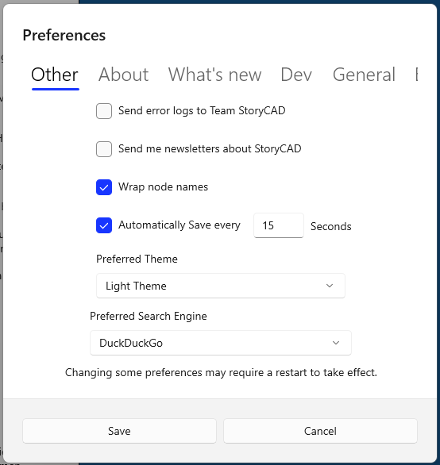
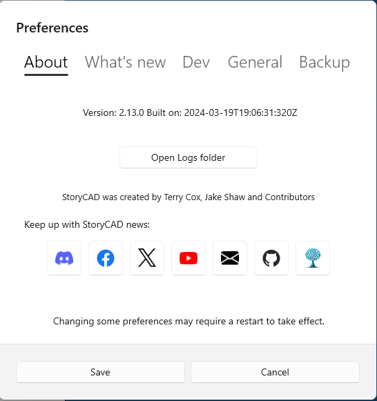
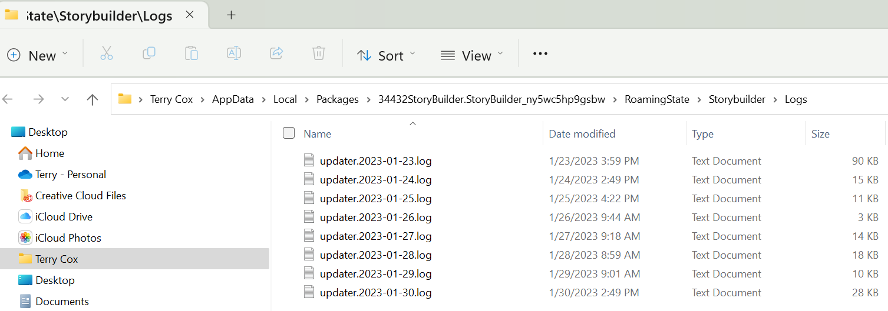
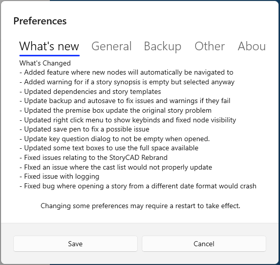

The Preferences Dialog will be displayed when you press the Preferences button on the Menu Bar:

The Preferences Dialog contains many options. It’s divided into a series of tabs which group the functions.

Account tab:

The name fields are used as the default Author on the Story Overview form on new outlines.

The name and your email address are used as your StoryCAD userid. The email address is also used with the elmah.io and newsletter options if you select those.

Delete My Data permanently deletes your account, your error reporting preferences, and your version tracking history from our servers. Your story files on your own computer are not deleted. It does not remove you from our email list; to stop receiving emails, use the Unsubscribe link at the foot of any email we send you. StoryCAD closes after the deletion.

Save Locations tab:

The project directory is the default directory for new story outlines.

The backup directory is the folder which will hold your backups. It holds a subfolder for each outline (.stbx file) you’ve backed up; the subfolder has the individual backups of your outline:

Backup tab:

StoryCAD backups are  zip files containing your .stbx outline. 

Automatically Save every - This function will automatically save your story outline every X seconds. It operates exactly as if you’d used File > Save or clicked on the edit button on the status bar.  You’ll see a verification of the save event on the status bar and the edit button will turn green. The interval can be from 15 to 60 seconds.

Make a backup of the story when opened - Makes a backup when you open a story

Make timed backups - Makes a timed backup every so many minutes.

How often should backups be made? - How often a timed backup should be made in minutes.

Privacy tab:

Send error logs - This option uses a service, elmah.io, which collects error data and provides us with a log which gives us an idea of what happened. This information includes your email so that we can follow up for more information if needed. Your outline data is not retained or forwarded and no information is shared with anyone outside of Team StoryCAD.

Send anonymous usage statistics - Sends the StoryCAD team a small anonymous record of how you use StoryCAD each time you close it. It never includes the content of your outlines. The ? button beside it opens an explanation of what is collected, and [Usage Statistics](Usage_Statistics.html) lists it in full. The change takes effect for your next session.

Send me StoryCAD newsletters - Your email address will be subscribed to the StoryCAD newsletter, which is usually sent about once a month.

Advanced logging - Makes StoryCAD write much more detail to its daily log files, which helps if we ask you to chase down a problem. Leave it off otherwise. It takes effect the next time you start StoryCAD.

Other tab:

Wrap node names - Wraps node names in the Story Explorer and Narrator treeviews, if the Name is longer than the treeview’s display width.

Show startup page - Shows the help dialog that offers a way to get started each time StoryCAD starts.

Show file picker on startup - Opens the file picker when StoryCAD starts, so you can choose the outline you want to work on.

Use beta documentation - Opens the beta version of this manual, instead of the released version, when you ask StoryCAD for help.

Show Collaborator - Shows the Collaborator and Buy Credits buttons on the StoryCAD toolbar, and on a Mac, the Collaborator item in the Tools menu. This box is checked to begin with. If you would rather work without Collaborator in view, clear it and click **Save**. The buttons disappear at once; you do not need to restart StoryCAD. Check the box again and click Save to bring them back. This setting hides the buttons only. The Collaborator pages of this manual stay where they are.

Hide in-window toolbar - This box appears only on a Mac. It hides the search and menu buttons inside the StoryCAD window so that you can use the Mac menu bar instead. It takes effect the next time you start StoryCAD.

Preferred Theme - This is the theme that StoryCAD will use. You can select between Light Theme, Dark Theme or to Use System theme, which will match the theme you have set within windows.

Preferred Search Engine - This is the search engine that will be used within web nodes. You can choose DuckDuckGo, Google, Bing or Yahoo.

About tab:

This tab identifies the current version and has links to keep up with StoryCAD on Social Media. You can also review StoryCAD here; additionally, you will also be prompted to review StoryCAD roughly once every six months.

The Open Logs folder button opens the logs folder, which is a subfolder of the installation folder. It contains a list of the most recent log files written by StoryCAD (one file per day.)

These files contain operational logs of StoryCAD sessions and if you’ve enabled exception reporting we may ask you to forward the log relevant to a reported exception, at your discretion.

The Discord server is the community meeting place for StoryCAD users; we urge you to join us.

What's new tab:

The What's new tab displays the Changelog for the current release. 
