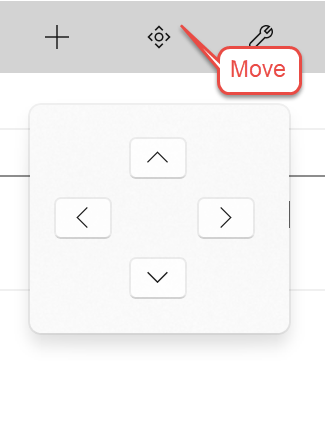

## Move Story Elements

The Move Story Element button displays a pop-up which allows you to move the selected Story Element node on the Navigation Pane up, down, left, or right. The exceptions are the top node of each view: Story Overview in Story Explorer and Narrative View in Story Narrator. 

(Hint: you can also just drag and drop a node from place to place.)
