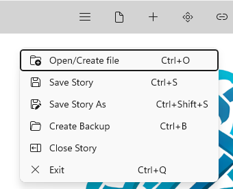
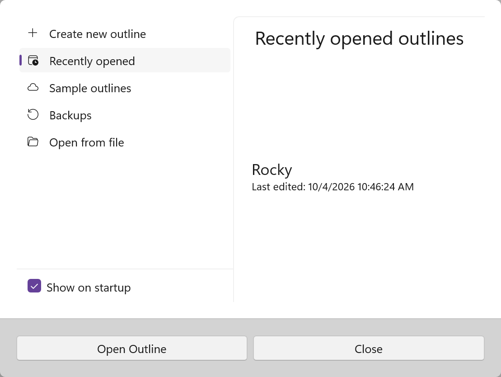
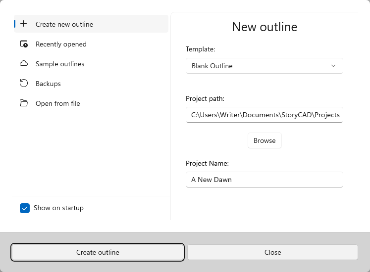

## Reading and Writing Outlines

The File Menu button displays a drop-down menu of file options:

A StoryCAD outline is a single file with a file extension of .stbx: for instance, 'The Maltese Falcon.stbx.'   A StoryCAD file can be moved, copied, etc.

StoryCAD .stbx files are fully compatible across Windows and macOS. See [Platform Differences](../Front%20Matter/Platform_Differences.html) for details on text formatting differences between platforms.

**Open/Create file** opens the dialog below, where you open an outline or start a new one. **Save Story** saves the outline under the name and folder it already has; a new outline gets those when you create it, so Save Story never asks for a file name. **Save Story As** opens a Save as dialog with a **New project Name** and a **Parent Folder Path**, to save a copy under a new name or in a new folder; StoryCAD then works on the copy. **Create Backup** makes a backup copy now. **Close Story** closes the outline and asks whether to save changes if there are any.

File Open displays the following open dialog:

The dialog opens on Recently opened, which lists the outlines you worked on last and when each was last edited. Click an outline, then click Open Outline. The other choices on the left are:

- **Create new outline** starts a new outline. The Project path defaults to the folder specified in Preferences.
- **Sample outlines** lists the sample outlines that come with StoryCAD. Changes to a sample are lost unless you save it somewhere else.
- **Backups** lists your backup copies, newest first. Click one, then click Open backup.
- **Open from file** opens a file browser so you can pick any outline on your computer.

Clear **Show on startup** if you don't want this dialog to appear when StoryCAD starts. Click Close to leave the dialog without opening anything.

Create new outline displays this page:

 
Only one story outline can be open at a time.  If you open another outline while the current one has unsaved changes, StoryCAD saves the current outline first, without asking.

