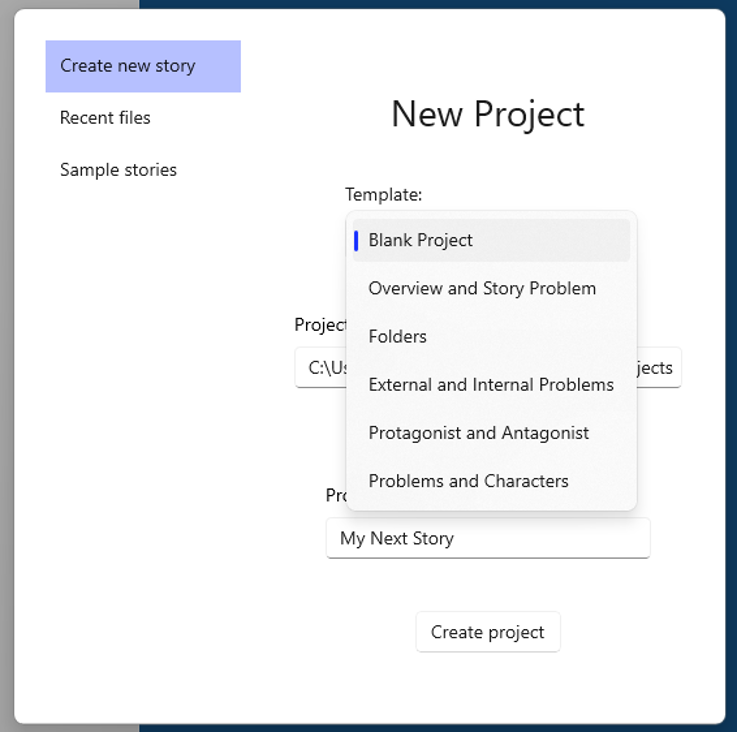
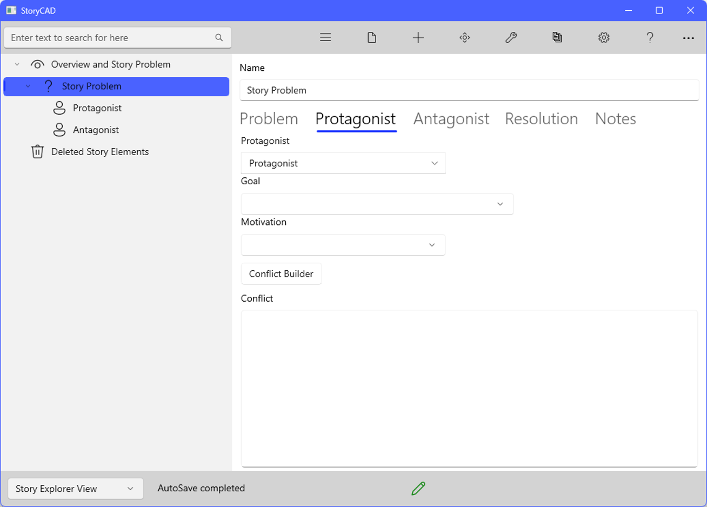

### Rearranging Content
Rearranging Content
Both the Story Explorer and Story Narrator views are trees of Story Elements. The root of the Story Explorer view is the Story Overview node, and the root of the Story Narrator view is a Folder node named Narrative View. Below that, you have complete control of the arrangement and order of Story Elements in the trees.
To aid in this process, both views contain a special Story Element type (Folder with Story Explorer and Section with Story Narrator) which are, as the names suggest, designed to do nothing but hold other Story Elements. The sample outline “Hamlet” uses folders in both views; its Story Narrator view groups the scenes into five acts.
Using folders is not a requirement, though: any node can be a parent node with children, or not. The sample outline “Land of Oz” uses this approach.
You can use any structure you like. For example, if you’re writing a John Jakes-style Civil War novel, you could create folders for Union and Confederate characters.
To help you get started, the File menu’s Open/Create file command has a Create new outline page with a Template drop-down which will populate your new outline with a starter set of Story Elements:

For example, the ‘Overview and Story Problem’ template will add these nodes:

You may find one or more of these templates useful early in your outlining process. However, your needs may change over time, particularly if you’re writing long-form fiction such as a novel or screenplay. To address this need, StoryCAD allows you to rearrange the nodes in your views, using two tools.
Drag and Drop

You can move a node to a different parent node by simply clicking on it and, while holding the mouse button or pen down, dragging it to the target node you want. When you let go, it becomes the last child of the node you dropped it on. 
Move Story Elements

The Menu Bar’s Move Story Element button can be used for finer control, such as moving a node up or down in a list of child nodes.  It can also move nodes to other parent nodes, but because each click moves just one node, it’s not as convenient as Drag and Drop when moving nodes over longer distances.

