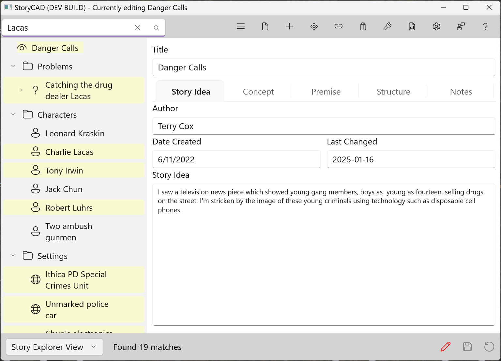

## Search

StoryCAD contains a search field, located at the left on the Menu Bar, which searches your outline for a word or phrase. To use it, enter the text in the search field and press Enter or click the search button (hourglass). Every story element that contains the text in any of its fields, in upper or lower case, is highlighted in pale yellow, the nodes above it open, and the Status Bar shows how many matches were found:

To clear the search, change the search text or click the X in the search field. The highlights and the match count disappear.

