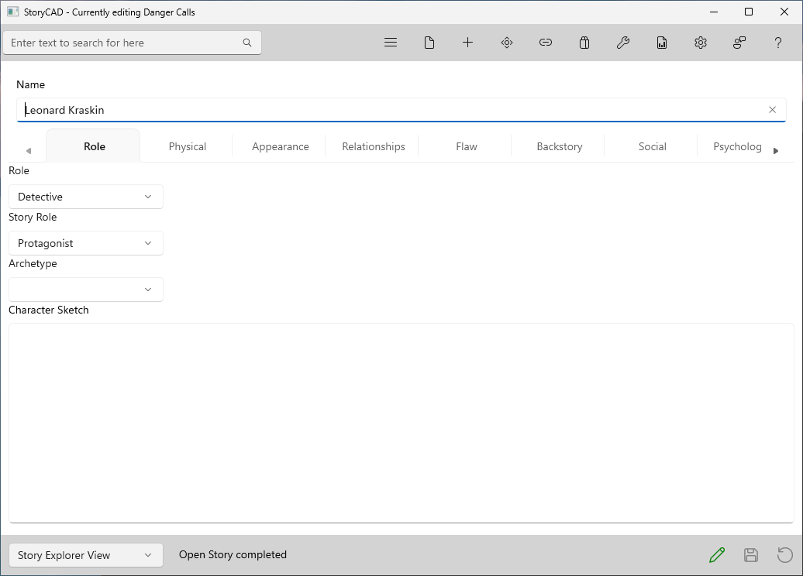
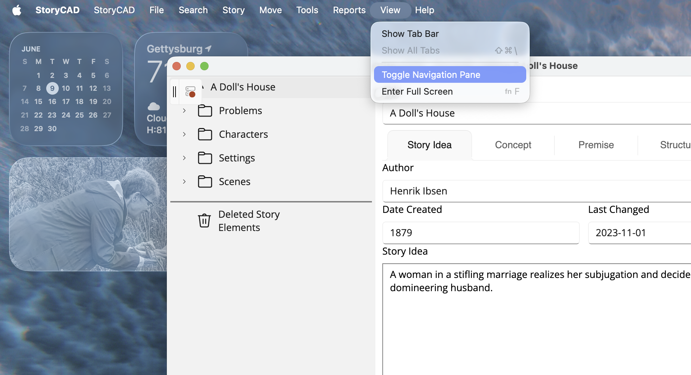

## Show/Hide Navigation Pane

This button (the hamburger button, the first button after the search box) toggles the Navigation Pane to either display or be hidden. Hiding the Navigation Pane makes better use of screen space on smaller screens or when the main form is sized smaller. It also encourages focus on just the one screen. Here the Navigation Pane is hidden:

When the window is narrower than 800 pixels, the button switches between the Navigation Pane and the Content Pane instead. See [Navigation and Content Panes](Navigation_and_Content_Panes.html).

(Hint: StoryCAD detects and reports spelling errors on most text fields.)

### macOS

On macOS, the same toggle is available in the native menu bar under **View > Toggle Navigation Pane**.

By default the in-window toolbar is also visible. To hide it and rely on the menu bar instead, open Preferences and turn off **Hide in-window toolbar** on the Other tab. The change takes effect on the next launch.
