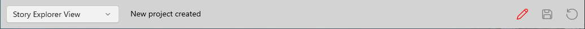

### Status Bar
Status Bar

The Status Bar reports information you may find useful during program execution. It contains the following controls:

View Selector

Allows you to switch between Story Explorer and Story Narrator views.

Story Explorer is the view in which you create and edit your outline. The order and arrangement of story elements in the Navigation Pane is entirely under your control.

Story Narrator is a separate display of your outline’s Scene Story Elements arranged into the order you wish to tell your story in.

Status Message

The Status Message displays feedback information from the program to you. Information messages clear after 15 seconds and warnings after 30 seconds; error messages stay until the next message replaces them.

Changed Indicator

The Changed Indicator, a pencil icon, displays red if any editing has been done to the outline and green if not. It’s a reminder to save your work. It’s also a command button which will save your outline if you click it.

AutoSave Indicator

The AutoSave Indicator is green when AutoSave is turned on and working.

Backup Indicator

The Backup Indicator is green when you or StoryCAD have made a backup of your outline recently. Click it to make a backup now.
