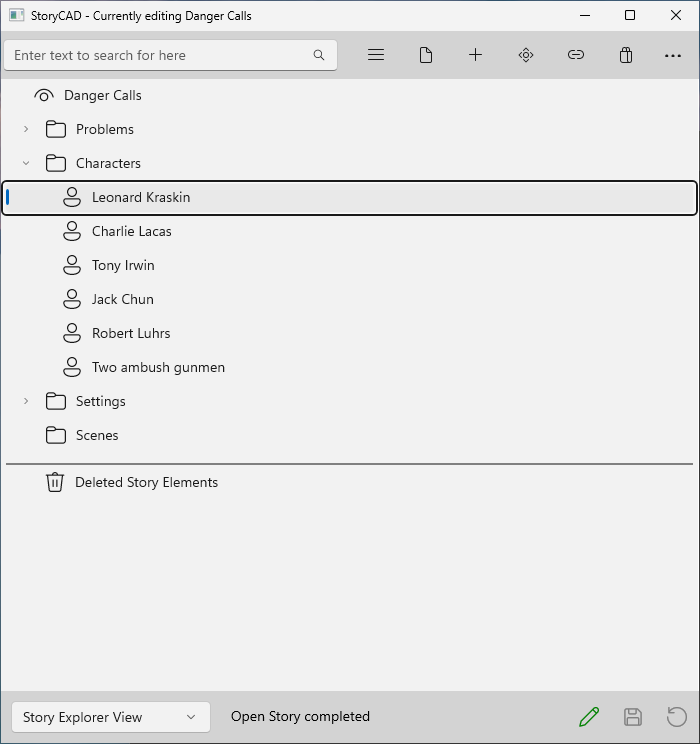

### Story Elements

Your outline is a tree of Story Elements which are displayed in the Navigation Pane. Clicking (or touching) a Story Element node on the Navigation Pane will display that Story Element’s  content in the Content Pane.

Clicking the first, or root, node in the tree displays the Story Overview form.

When the StoryCAD window is narrower than 800 pixels, it shows one pane at a time. The Show/Hide Navigation button (the hamburger menu button) then acts differently; it toggles from the Content Pane to the Navigation Pane and back.

Every Story Element type is a different form. These are the story elements:

	•	Story Overview 
	•	Problem
	•	Character
	•	Setting
	•	Scene
	•	Folder
	•	Section
	•	Web
	•	Notes
	•	StoryWorld

Your outline has only one Story Overview; it’s created automatically when you open or create a new outline. The Story Overview is the root of the Navigation Pane tree, and all other Story Elements are below it. 

Most forms also have a full-page tab (labeled Notes) which holds your general notes and thoughts regarding the story element. We won’t talk about these again; just be aware that they’re there.
