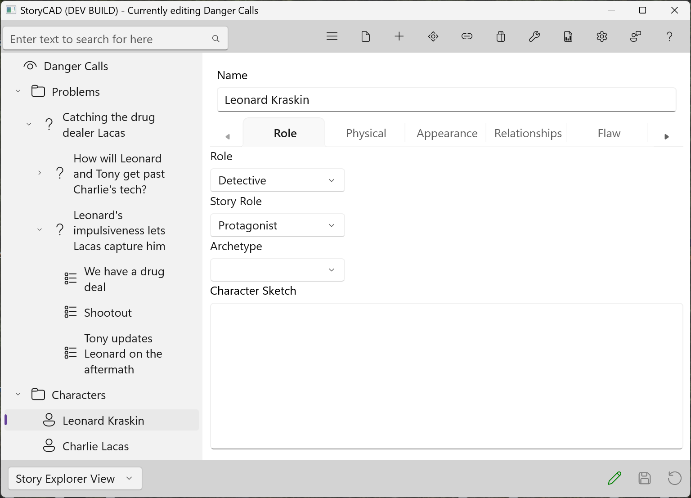

### Tabs

For most Story Element types, that Form contains multiple tabs. Clicking or touching a tab name will switch to that tab’s content. 

Tabs allow you to easily switch between different sections of a form, rather than having to navigate through multiple separate pages or windows. A tab organizes and groups related information.

Some forms, such as the Character form, have more tabs than fit across the window, and a smaller window shows fewer. The tabs then form a carousel you can scroll left or right by using the left or right arrows at the edges of the tab area.

