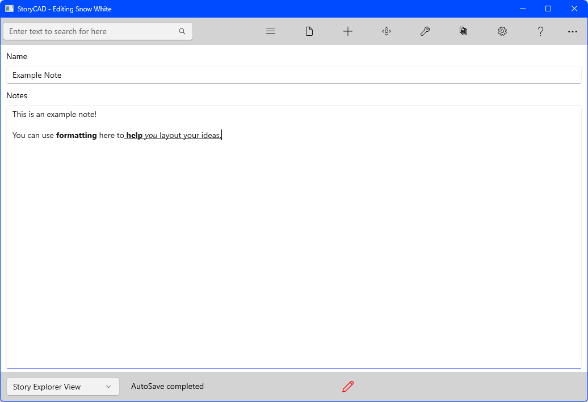

## Notes Form
Notes forms can store any information you wish anywhere in the outline. Most story elements include a Notes tab; however, you can add Notes forms for more in-depth research and store these anywhere within your outline.

On Windows and macOS, you can format text with bold, italic and underline from the right-click menu, and StoryCAD checks your spelling. See [Platform Differences](../Front%20Matter/Platform_Differences.html) for details.

A Notes form also has an **Images** tab for attaching pictures. See [Images Tab](../Story%20Elements/Images_Tab.html).

