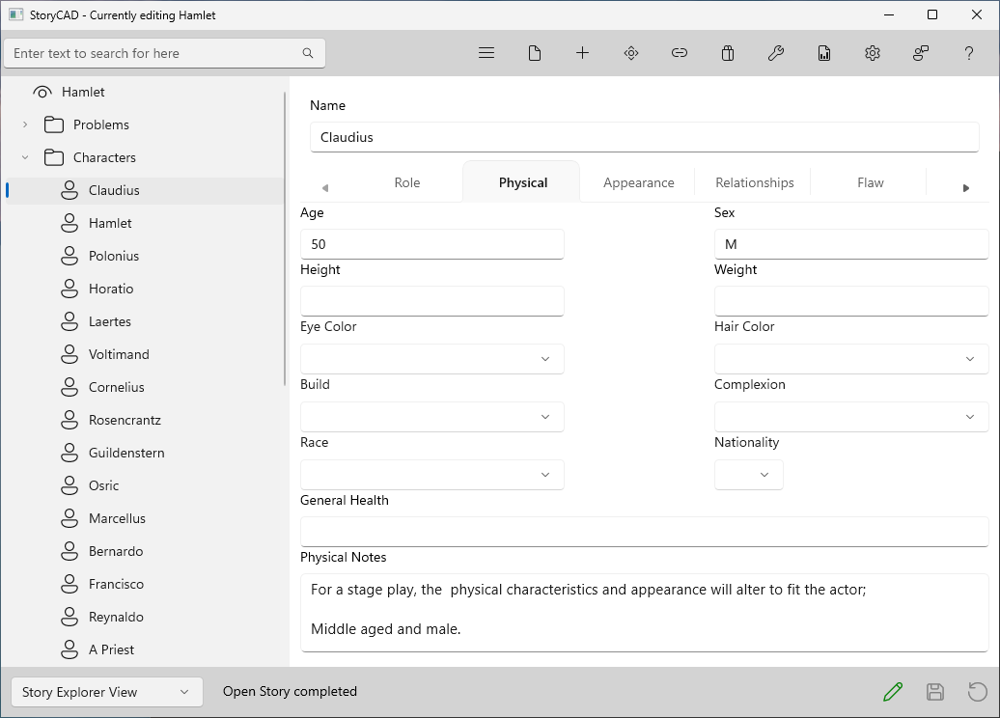

### Physical Tab
Physical Tab

These character traits describe the external physical characteristics of the character.  They are generally self-explanatory.

The tab has Age, Sex, Height, Weight, Eye Color, Hair Color, Build, Complexion, Race, Nationality, General Health and Physical Notes.  Eye Color, Hair Color, Build, Complexion, Race and Nationality are drop-down lists; you can pick a choice or type your own.

Use the [Appearance tab](Appearance_Tab.html) to round out the physical description of the character with looks, style of dress, etc.