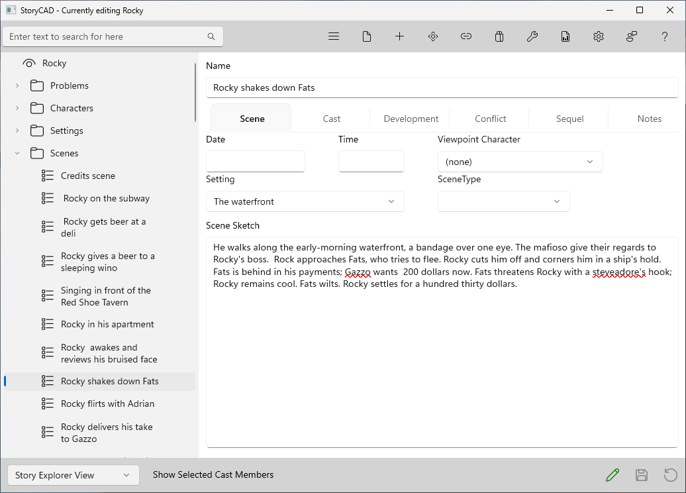

### Scene Tab

Date, Time		Identify when the scene occurs.  They are two separate fields.

Viewpoint Character		Choose from the story's characters.  Viewpoint should generally not change within a single scene.

Setting		This control lists the settings defined on the Setting form.  Select one of the listed settings to provide a backdrop for the scene.

SceneType		The kind of scene, such as Climax scene, Crisis scene, or Transition scene.  You can pick a choice or type your own.

The scene's characters are on the Cast tab.  The number of characters in a scene should be limited to those who contribute to the scene's purpose and dramatic structure.

Scene Sketch		A thumbnail sketch of the scene.

