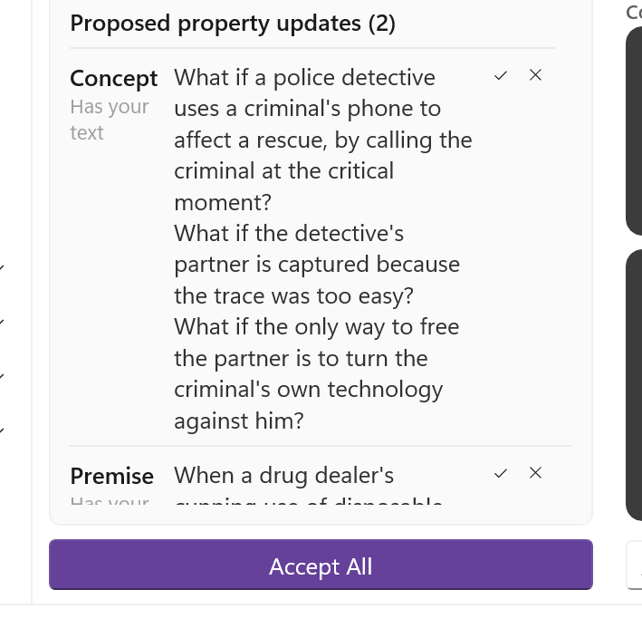
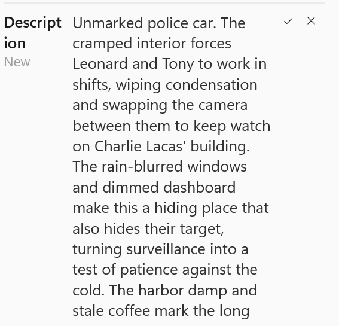
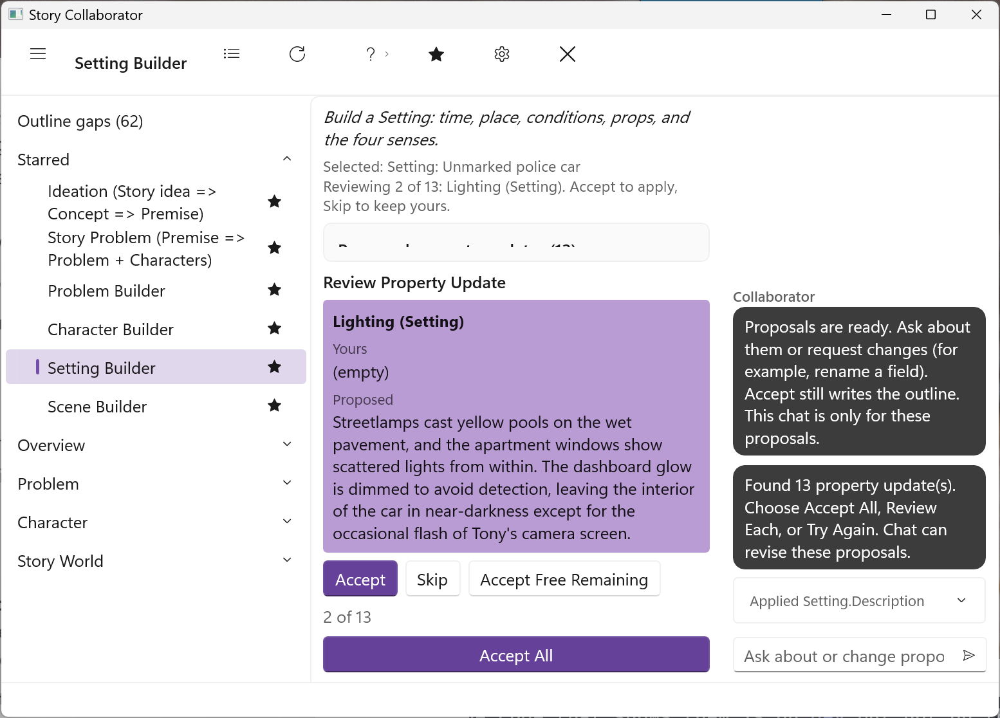

# Reviewing Suggestions

Reading the suggested changes before you accept them is the habit that makes Collaborator safe to use. Collaborator proposes and you decide, and this page explains what the list shows you and what each of your choices does.

## The Property Updates list

After a run, the center of the window fills with a list headed Proposed property updates. Each row is one field on one story element, for example, the Premise on the Overview or the protagonist's Goal on a Problem, with the proposed text beside it. The header counts the rows. The status line in the chat column, and the line above the list, tell you how many of them would replace text you wrote; the chat line also names any fields Collaborator kept as they are. If three proposals are waiting and one would replace your text, the other two apply on their own when you click **Accept All**, and that one does not change until you confirm it.

## What the row labels mean

Under each field name is a label saying how Collaborator classified the field against what your outline already holds.

| Label | What it means | What Accept All does |
|-------|---------------|------------------------------|
| New | The field is empty | Applies it |
| Refresh | Collaborator wrote this field earlier in the same session | Applies it |
| Has your text | You, or your past edits, already filled the field | Asks first. **Replace** writes the proposal; **Cancel** keeps your words |
| Update | A field that holds a list rather than a single value, so there is nothing to compare line for line | Applies it |

Each row also has two small buttons at its right. The check mark accepts that row alone, and the X drops it. Accepting a Has your text row this way does not write it at once: Collaborator holds it, and when the last row in the list is decided, it asks once whether to replace your text in all the rows it held.

The New, Refresh, and Update rows are the free ones, and the Has your text rows are the ones that would replace text you wrote. This is how your writing is protected when you run a workflow a second time on a half-filled outline: a field you filled yourself, or accepted earlier and then edited, is never replaced without asking you first.

## Accept All

The **Accept All** button sits at the foot of the list. It updates every New, Refresh, and Update row. If any Has your text rows are waiting, it first asks whether to replace them: **Replace** writes those too, and **Cancel** leaves your text alone. Use it when you start from empty fields and want the first pass written quickly. Afterwards, open the same element in StoryCAD and skim the form; the text is already there.

## Review Each

Click **Review Each** on the top bar to walk the list one field at a time. For each field the card shows Yours, the text in your outline now, and Proposed, what Collaborator suggests, with a count such as 1 of 6 so you know where you are. Three buttons follow. Accept writes the proposal into this field only; on a Has your text field it holds the proposal for the one Replace question at the end of the list. Skip keeps yours and drops the proposal. Accept Free Remaining applies to every remaining New, Refresh, and Update row in one step and leaves the remaining Has your text fields for you to Accept or Skip one by one.

Accept Free Remaining is not the same as accepting every empty field. It also applies the Refresh rows, the fields Collaborator wrote earlier in this session, and it never overwrites a Has your text field in bulk.

## Try Again

Try Again on the top bar discards the waiting set and runs the same workflow again; [Running a Workflow](Running_a_Workflow.html) describes it. Use it instead of accepting a weak pass and editing afterward.

## Nothing is permanent until you accept it.

Closing Collaborator without accepting leaves the fields as they were. Accepting writes the text into your outline at once, so there is nothing further to do to keep it, and if you accept a suggestion and dislike it later, edit the field in StoryCAD as you would any other text. The system does not lock you in.
