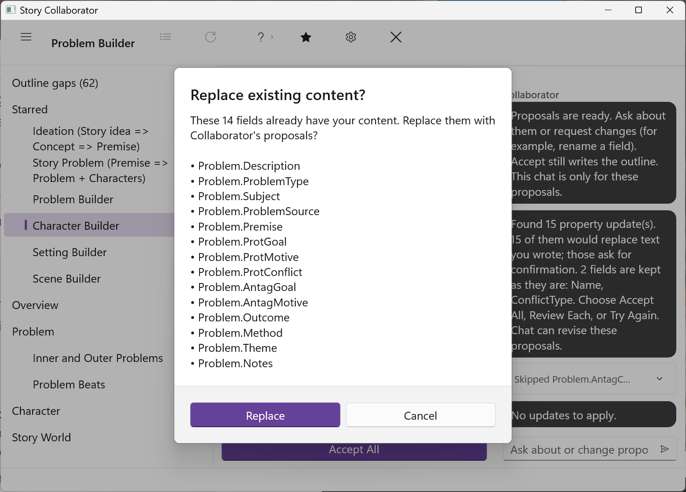
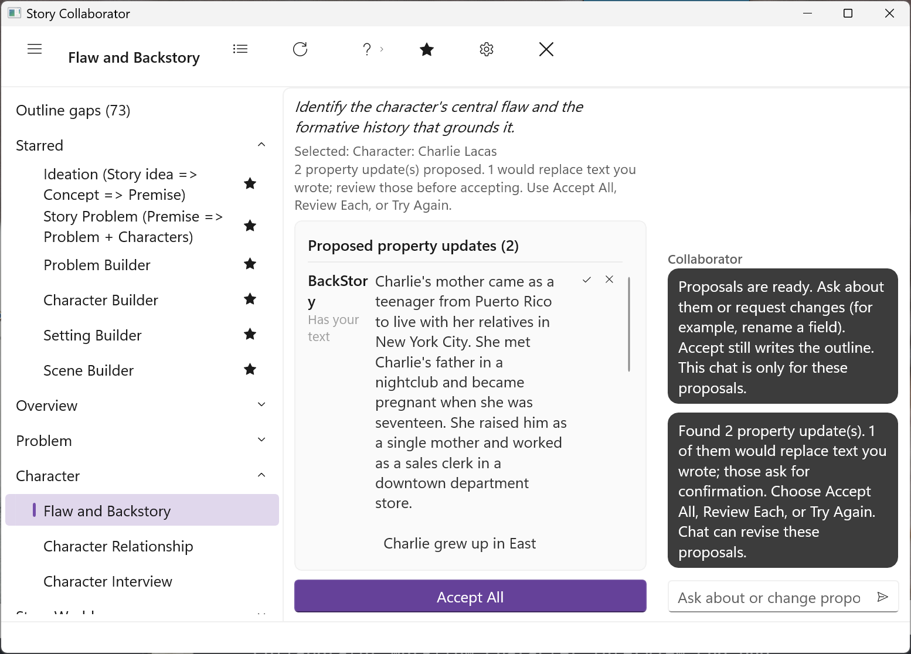
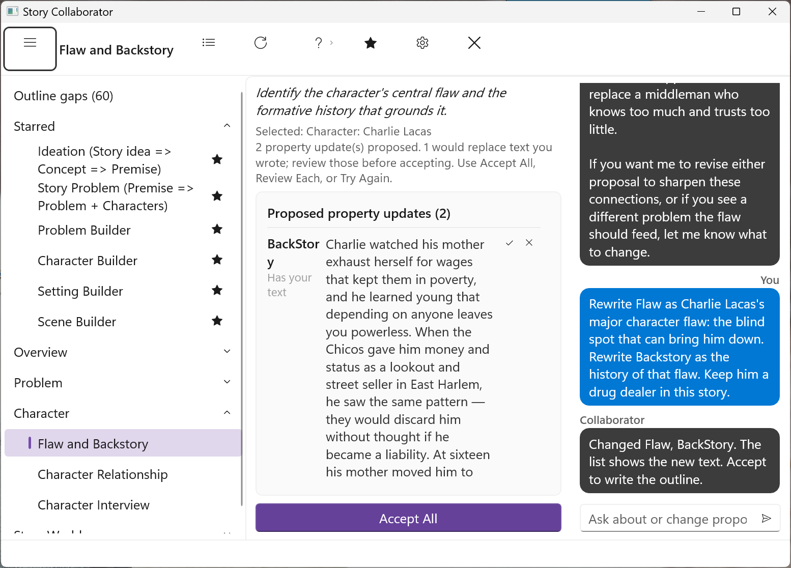
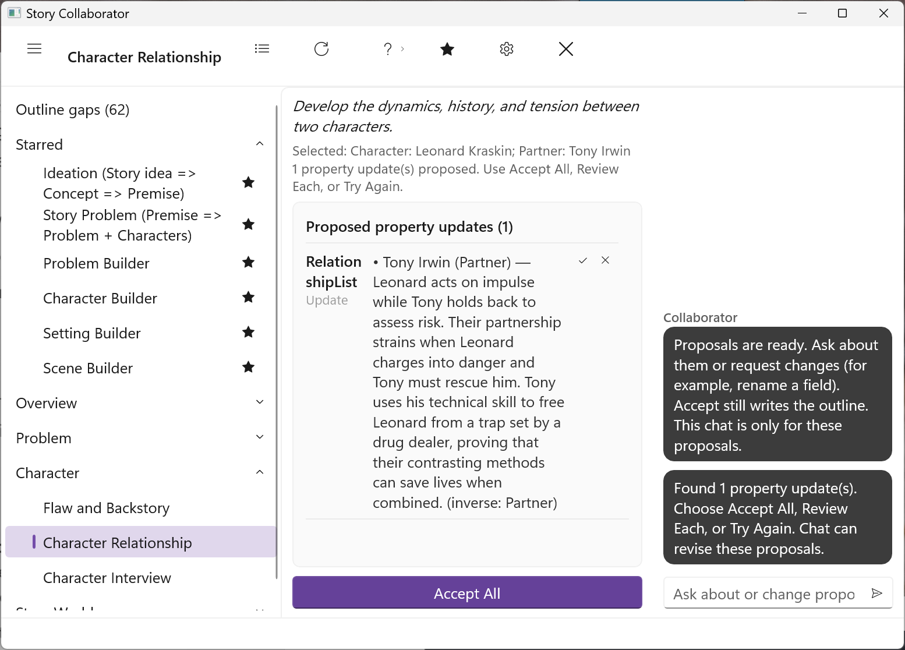
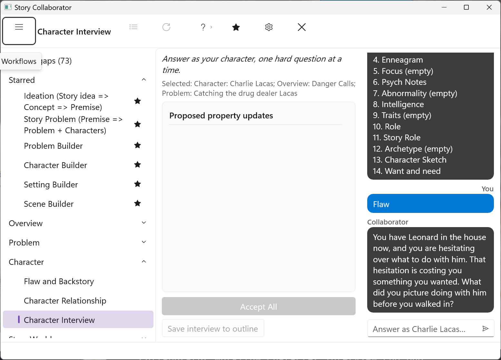
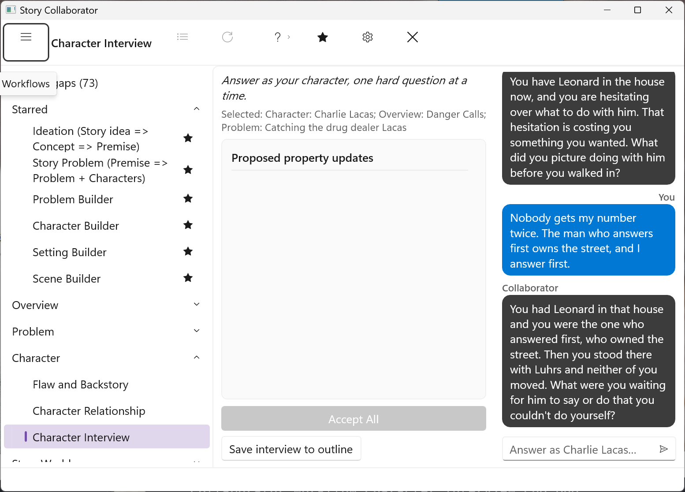

# Character Workflows

These workflows work on one Character at a time, and each opens a picker so you can say which. [Defining Characters](../../Writing%20with%20StoryCAD/Defining_Characters.html) is the craft behind them, and the [Character Form](../../Story%20Elements/Character_Form.html) pages describe the tabs they write. They divide the work: Character Builder fills who the person is in the world and what they are for in the plot, Flaw and Backstory writes the wound and its history, Character Relationship drafts how two people stand with each other, and Character Interview asks you questions in the character's voice instead of filling the form.

## Character Builder

The Character form has two kinds of fields. Some describe the person in the world: Role for occupation; Physical for age, sex, and build, and Appearance for how they look; Social for background; Psychological for how they think; and Inner Traits and Outer Traits for temperament and habit. Others describe the character's place in the plot: Story Role, Archetype, and the Character Sketch. The [Role Tab](../../Story%20Elements/Role_Tab.html) page covers both the occupation Role and the Story Role, which says how much of the story rests on the character (Protagonist, Antagonist, Major, Supporting, Minor, or Service), and the Archetype, which names the pattern they play out: Hero, Mentor, Threshold Guardian, and the rest of Joseph Campbell's list.

Character Builder fills both kinds in one pass, so the sheet and the plot function stay consistent with each other and with any Problem where the character is protagonist or antagonist. The Character Sketch comes last, written as its own short step: one or two sentences on who this person is, drawn from their values, focus, temperament and flaw, and on how that person meets the story. The plot facts stay in the Problems and the other tabs. It is not a physical description. Character Builder does not set the Flaw or the Backstory; Flaw and Backstory handles those. It is one of the six workflows starred when you first open Collaborator, and it is a sensible first workflow to run on any new character.

Pick the Character. The run proposes the occupation Role, Age, and Sex; the Social fields; Eyes, Hair, Build, Complexion, and the Appearance note; the Psychological fields; the Inner Traits and a list of Outer Traits; then Story Role, Archetype, and the Character Sketch. That is a long Property Updates list, and Review Each is the comfortable way through it.

## Flaw and Backstory

The [Flaw Tab](../../Story%20Elements/Flaw_Tab.html) page calls a major flaw the root of a character arc: the thing that must be corrected, or will bring the character down. The [Backstory Tab](../../Story%20Elements/Backstory_Tab.html) page describes backstory as the history that explains a character's traits and motives, and warns against shoehorning explanations into it. The two belong together, since a flaw without a history is only a label, and this workflow writes them as a pair.

Pick the Character. If both fields are empty, the run proposes a flaw and a focused history that grounds it. If you have already written either, it keeps your facts and weaves the wound into them rather than replacing them; a filled field shows as Has your text and waits for your review. The Problems the character is linked to set the stakes, and where one of them is Person vs. Self the run leans on it. Inner and Outer Problems can also write the Flaw from the problem side. Flaw and Backstory will propose a new Flaw even when one is already there; **Accept All** replaces it once you click **Replace**. The last accept wins. If you want to keep the Flaw you have and only take the Backstory, use **Review Each** and skip the Flaw row. This workflow does not touch the Story Role, the Character Sketch, the sheet fields Character Builder writes, or Relationships.

On Charlie Lacas, the drug dealer in the Danger Calls sample, the first run proposed two rows, Backstory and Flaw. The sample already gives Charlie a Backstory, so that row shows Has your text. The proposed Backstory is family history: his mother came from Puerto Rico as a teenager and raised him alone on a sales clerk's pay. It does not say what made him a dealer.

Judge the Flaw row against the Flaw Tab page before you accept. If it is a tactic or a plot beat, leave the list as it is and use the proposal chat. [Chat](../Chat.html) and [Reviewing Suggestions](../Reviewing_Suggestions.html) cover how the chat edits waiting rows. Ask for a major character flaw, the wound or blind spot that can bring this person down, and a backstory that is the history of that wound, in this story.

On Charlie, that chat was:

Rewrite Flaw as Charlie Lacas's major character flaw: the blind spot that can bring him down. Rewrite Backstory as the history of that flaw. Keep him a drug dealer in this story.

Collaborator answered "Changed Flaw, BackStory," and the list updated in place. The new Backstory is the history of the flaw: Charlie watched his mother wear herself out for wages that kept them poor, learned that depending on anyone leaves you powerless, and found money and status as a lookout and street seller in East Harlem.

## Character Relationship

The [Relationships Tab](../../Story%20Elements/Relationships_Tab.html) page describes a relationship as a dynamic between two people, distinct from either of them as an individual, and notes that the two sides of it seldom match. This workflow drafts that dynamic. It asks for two characters in turn, the Character and the Partner, and it works best when each has some sheet fill from Character Builder or Flaw and Backstory, though it runs on thin sheets too. It uses the traits you have filled and does not invent the ones you have not.

Accepting writes a relationship entry on both characters' Relationships tabs: the relationship type, the field the tab labels "is a," together with a Trait, an Attitude, and Notes. The Relationships Tab page explains each of those fields and how to edit the entry afterward. The two sides of a relationship seldom match. If the Notes on both people are the same paragraph, or the type is wrong for the story, that is a template problem, not something to paper over in the chat for a first pass. Edit the entries in StoryCAD after you accept.

On Leonard Kraskin and Tony Irwin, the run typed Tony as Partner and wrote notes about Leonard's impulsiveness: Tony has to pull him back from rash decisions, and rescues him when he rushes into the trap at Lacas's house.

## Character Interview

The other character workflows fill the form. Character Interview does not. It asks you the questions the form cannot: what the flaw once protected, what the character will not trade away, what they refuse to hear. You answer in the first person, as the character. Collaborator never speaks as the character, and it does not write to Role, Story Role, or the Character Sketch. The record is the conversation itself.

Pick the Character. A second picker offers a Problem for the interview to keep in mind; it is optional, and Cancel goes on without one. Collaborator then asks what to explore, offering the Character form's labels plus Want and need, or you can let it choose from the form and the character's Problems. Each turn is one question. You decide when it is over. It may keep asking about the same field, often Flaw. Click **Save interview to outline** when you have enough. That button writes the transcript, and so does switching to another workflow or closing Collaborator with unsaved answers. Saving the outline in StoryCAD does not. The questions and your answers are stored as a note under that character, and saving again during the same interview updates that note rather than adding a second one; a later interview adds a note of its own. The Property Updates list stays empty, because there are no field proposals to accept, and **Accept All** stays disabled.

