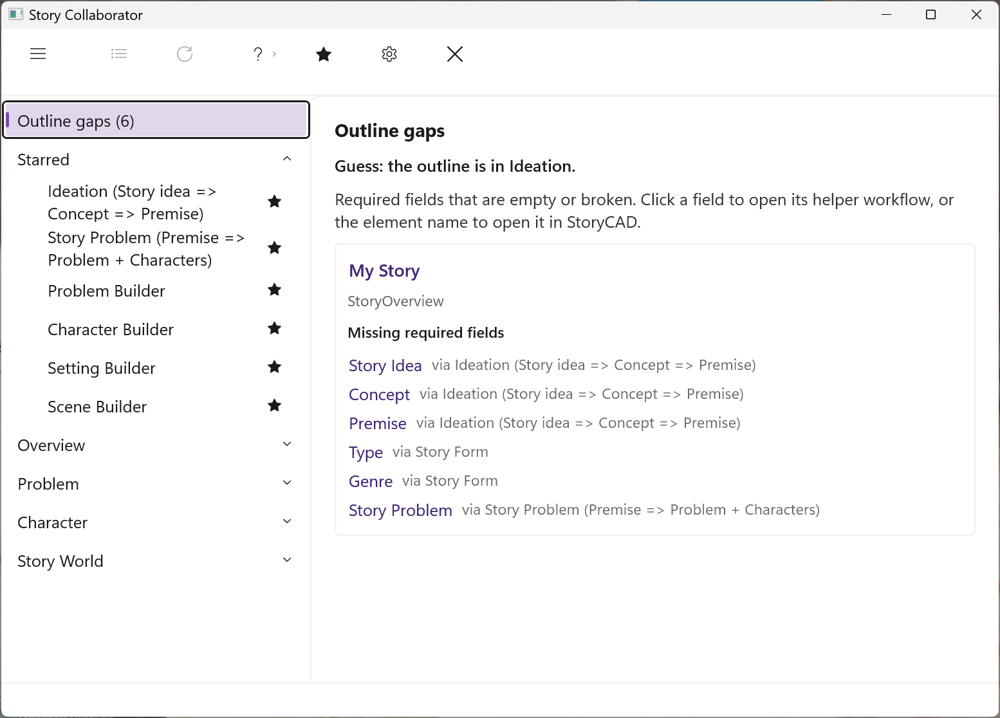
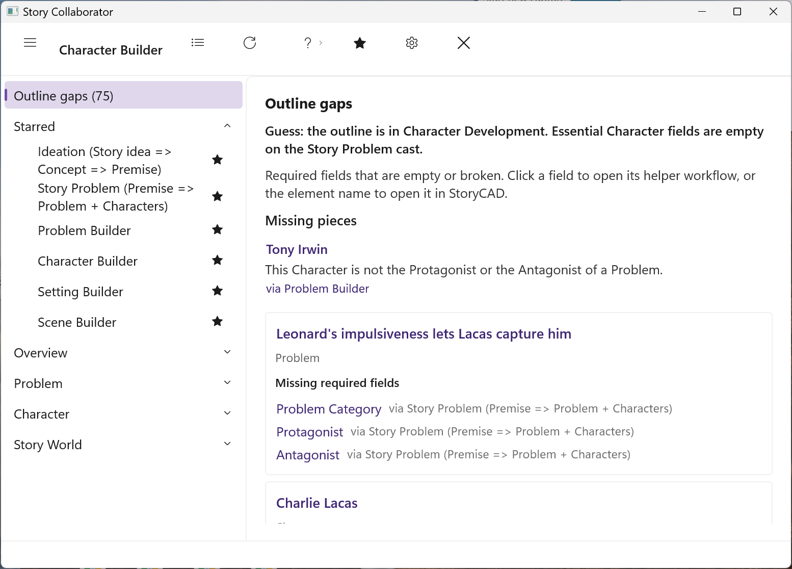

# Outline Gaps

StoryCAD's forms have many fields, and you are never required to fill them all. Collaborator, though, treats a short list of fields on each kind of story element as required: the ones its workflows read, and the ones a story cannot do without, such as a Story Problem on the Overview or a protagonist on a Problem. When you open Collaborator, it checks every Overview, Problem, Character, Setting, Scene, and your Story World if you have one, against that list. It also looks for missing pieces of the story, described below. If anything is missing, an Outline gaps row appears at the top of the workflow list with a count of the missing fields and missing pieces together. When nothing is missing, the row is not there. Elements in the trash are not checked.

## What the page shows

Clicking Outline gaps does not run anything. It opens a page in the center of the window headed, in the app's own words, "Required fields that are empty or broken. Click a field to open its helper workflow, or the element name to open it in StoryCAD." Below that comes the list of missing pieces, when there are any. After it, your elements with gaps are listed by type, the Overview first, then Problems, Characters, Settings, the Story World, and Scenes, alphabetically within each type, each with its missing fields under its name.

Each missing field is a link, and the small text beside it tells you what the link does. Where a Collaborator workflow can fill the field, the text reads "via" and the workflow's name, and clicking it starts that workflow; you choose the element in the picker as usual. Where no workflow applies, for example the Author field on the Overview or an element's Name, the text reads "edit in StoryCAD," and clicking the element's name selects it in StoryCAD's navigation pane so you can type the value yourself.

A sentence at the top of the page beginning "Guess:" tells you where Collaborator thinks your outline stands. The last section of this page explains it.

## Missing pieces

A field can be filled while a piece of the story is still missing. The Missing pieces list, at the top of the page, names two kinds:

- **A Problem with no Scene.** No scene sits on the Problem's beats, or on the beats of any Problem placed on those beats. The link opens Problem Beats, which chooses a beat sheet and fills the empty beats with scenes. Problem Beats never changes a beat you have filled, so a Problem whose beats hold only other Problems stays listed until one of those Problems gets a scene; those Problems are listed too.
- **A Character in no Problem.** No Problem names the character as its Protagonist or Antagonist. The link opens Problem Builder. Choose or create a Problem in its picker; if that Problem's Protagonist or Antagonist is empty, a second picker asks for a character and puts your choice there. A character can only go into an empty seat. If you cancel a picker, the workflow stops.

A character whose Story Role is Supporting Role, Minor Role, or Service Role is not listed. Those characters aren't meant to carry a Problem. A Scene that sits on no beat isn't listed either, because nothing says which Problem it belongs to.

As with a field, the link opens the workflow, and you choose the element in its picker. Click the element's name to select it in StoryCAD instead.

## The required fields

| Story element | Required fields | Which workflow helps |
|---|---|---|
| Story Overview | Name (the Title on the Overview form), Story Idea, Author, Concept, Premise, Type, Genre, Story Problem | Ideation (Story idea => Concept => Premise) for Story Idea, Concept, and Premise; Story Form for Type and Genre; Story Problem (Premise => Problem + Characters) for the Story Problem. Title and Author you type in StoryCAD. |
| Problem | Name, Story Question, Problem Category, Problem Type, Conflict Type, Subject, Premise, Protagonist, Antagonist, the Goal, Motivation, and Conflict for each of them, and Outcome | Story Problem (Premise => Problem + Characters) for the category and the two characters, and a first pass at the rest; Problem Builder for the goal, motivation, conflict, and outcome fields. Name you type in StoryCAD. |
| Character | Name, Character Sketch, Role, Story Role, Age, Sex, Appearance, Backstory | Character Builder for Role, Age, Sex, Appearance, Story Role, and Character Sketch; Flaw and Backstory for Backstory. Name you type in StoryCAD. |
| Setting | Name, Setting Summary, Locale, Period | Setting Builder for Setting Summary, Locale, and Period. Name you type in StoryCAD. |
| Story World | Name, World Type, World tell | Define Story World for World Type and World tell. Checked only when your outline has a Story World. Name you type in StoryCAD. |
| Scene | Name, Scene Sketch, Setting, Cast | Scene Builder for all three. Name you type in StoryCAD. |

## Where your outline stands

Every time a workflow runs, Collaborator tells the model which stage of outlining your story has reached, so that its suggestions fit an outline at that stage rather than a finished one. It decides the stage from the outline itself, checking in this order and stopping at the first condition that holds:

1. Ideation. The Overview's Type, Genre, or Premise is empty. The story is still an idea.
2. Problem Development. Those three have been filled, but the Overview's Premise tab does not show a chosen Story Problem, or the chosen problem's Protagonist or Antagonist is not linked to a character.
3. Character Development. The Story Problem and its two characters are in place, but one of those characters is missing an essential field: Name, Character Sketch, Role, Story Role, Age, Sex, Appearance, or Backstory.
4. Place and World Development. The cast is complete, but a Setting, or the Story World, is missing its Name, its summary (the Setting Summary or the World tell), a Setting's Locale or Period, or the World Type.
5. Structure Building. The places are complete too, but no scene has been allocated to a beat on the Story Problem's beat sheet or on any of its sub-problems.
6. Scene Work. At least one scene sits on a beat. The outline has a shape, and the remaining work is inside the scenes.

The order is a default, not a rule. You can work on places before characters, or scenes before either; the guess simply names the first step it finds open.

The same judgment appears to you as the Guess sentence on the Outline gaps page: "Guess: the outline is in Problem Development," for example. When the Story Problem is chosen but its protagonist or antagonist isn't linked, the sentence says Problem Development and Character Development are both open, and adds that the Story Problem still needs its protagonist and antagonist. It is a guess in the plain sense. It comes from which fields are filled, not from reading your prose, so if it seems wrong, the table above shows which fields it is looking at.

After the spine workflows, the page still lists what is empty. The count is higher. The Guess sentence should have moved past Ideation.

