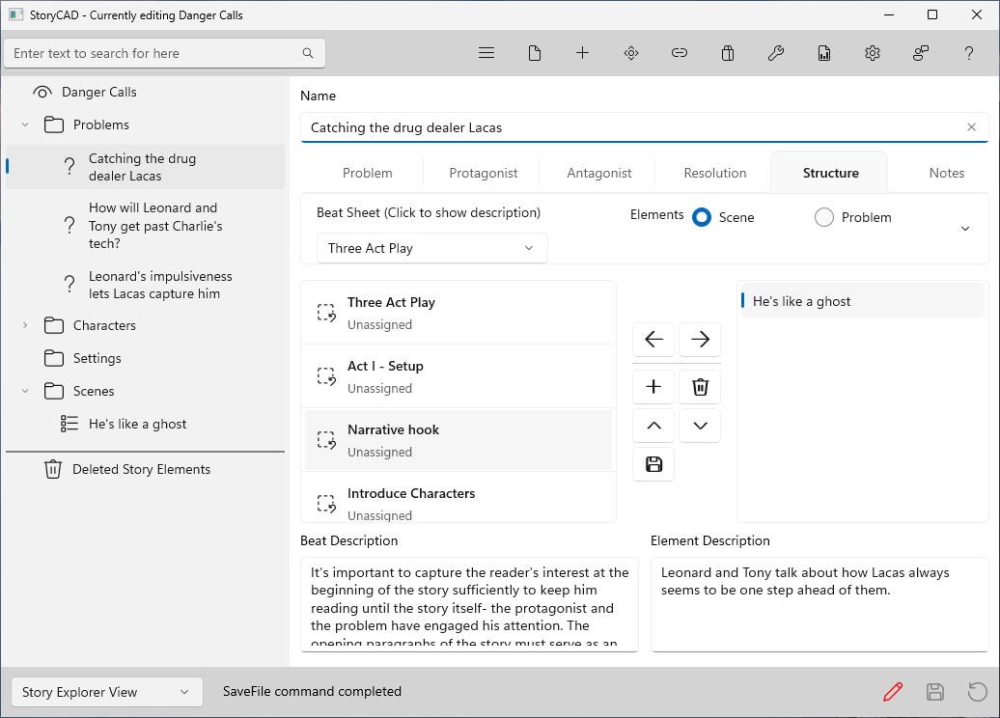
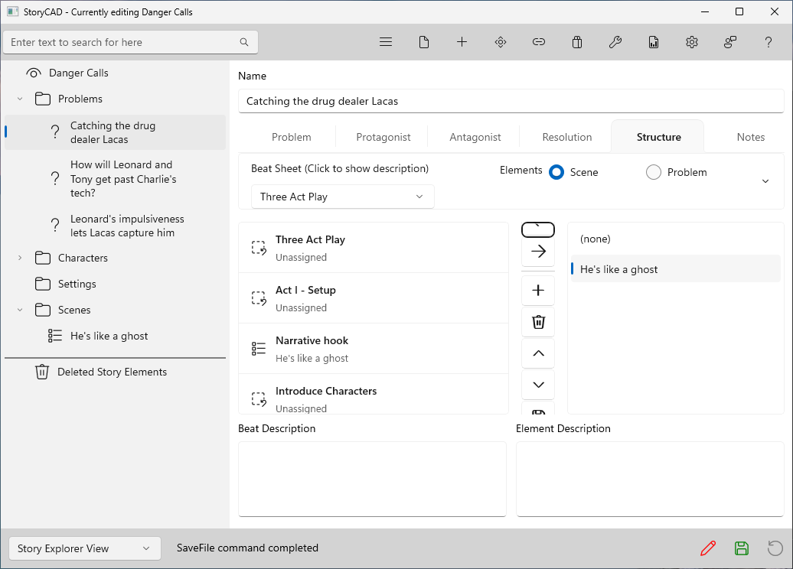
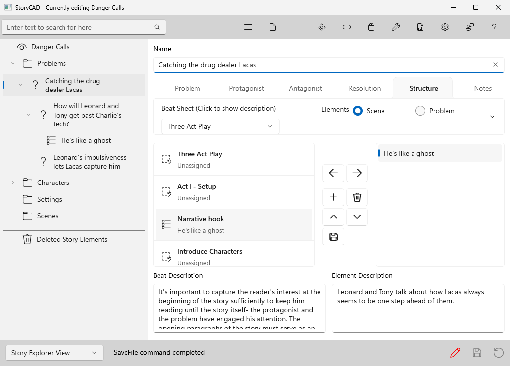
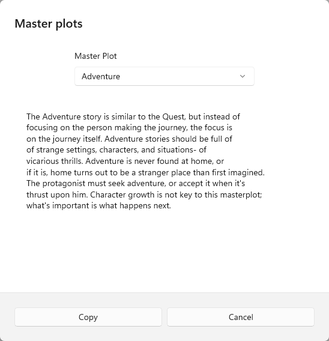
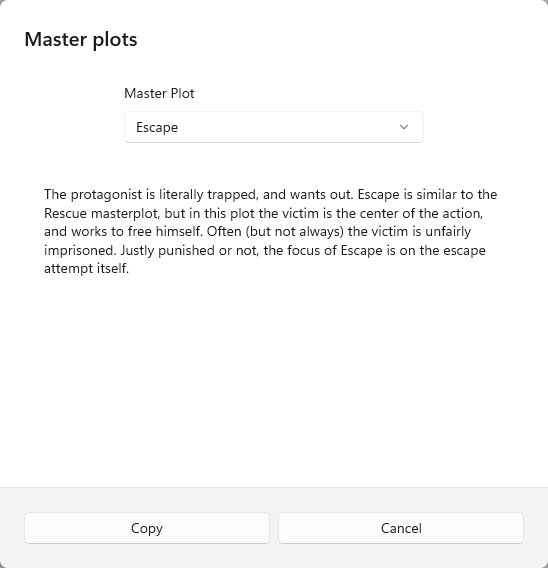
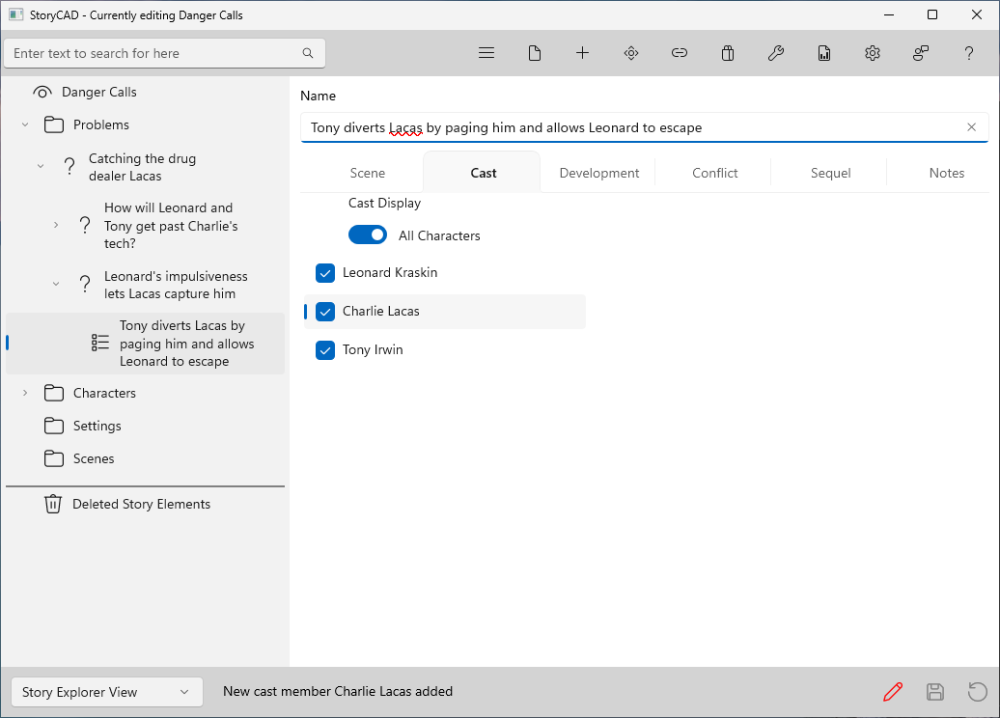

## Creating a Story pt 6
Story structure is the closest you have to a recipe for plotting your story. Your goal, in following a template story structure like the beat sheets on the Structure tab, is to create scenes for your story that fit into the structure you’ve chosen, and to position them accordingly. The scenes you’ll use are what develops from your characters trying to solve their problems.
 
‘He’s like a ghost’, the scene we added earlier, is our ‘Narrative hook’. With the beat selected, the Structure tab lists the scenes and problems you can assign to it:

Select ‘He’s like a ghost’ and click Assign. The beat now shows the scene:

Each beat describes one function, but it’s wrong to think that a real scene only does one thing. The ‘He’s like a ghost’ scene, our Narrative Hook, also Introduces Characters- not all of them, but our protagonists, Leonard Kraskin and Tony Irwin, and, from a remove, our antagonist, Charlie Lacas. It also Presents a Problem to be Solved- ‘How will Leonard and Tony get past Charlie's tech?’, which is in fact a sub-problem of the Story Problem, ‘Catching the drug dealer Lacas’.  To illustrate, here’s a reorder of the Problems.

The two sub-problems have been moved under the main problem, and our one scene so far (‘He’s like a ghost’) has been moved under the problem it’s a part of.  You move a node by dragging it onto its new parent.

Back when we worked on our story idea we already had an idea of what our climax scene would be. The Master Plots tool, on the Tools menu under Plotting Aids (or Ctrl+M), offers patterns of action that recur in fiction. Right-click on the ‘Leonard's impulsiveness lets Lacas capture him’ problem, then open Master Plots:

Pick Escape and click Copy:

Master Plots adds the plot under the node you last right-clicked. Escape is one plot point, so it arrives as a Problem named Escape. Right-click on it and click Convert to Scene. We can make it our own by renaming it to 'Tony diverts Lacas by paging him and allows Leonard to escape’ and using our story Premise description. To add the cast, open the scene’s Cast tab, switch Cast Display to All Characters, and check each character in the scene.

The Three Act Play beat sheet on the story problem’s Structure tab contains a ‘Climax’ beat, with a description that reads:

   This is the point in which the story problem is solved, one
way or another. Either the protagonist succeeds in obtaining her
goal, or she fails, or she decides that the goal isn't worth obtaining
any more, or she discovers something that changes the situation- usually
something about herself. It's important that your protagonist takes
her fate in her own hands and solve, or try to solve, her own problem.
Having the calvary ride up at the last minute is no longer acceptable.

Our ‘Escape’ scene under the ‘Leonard’s impulsiveness lets Lacas capture him’ problem is this part of the story’s structure as well. 

Plotting is usually the last thing in story design to worry about, for several reasons.  The characters should be well defined, so that their actions are consistent with their natures.  The story problems should also be clearly understood, especially the resolutions.  Every problem is a story in miniature; plotting a story is largely a matter of arranging events from one or more problems into a satisfactory sequence.  But writing is a process of accumulation, and the ideas which you collect to create your story concept can come to you at any time.  If you visualize a scene.